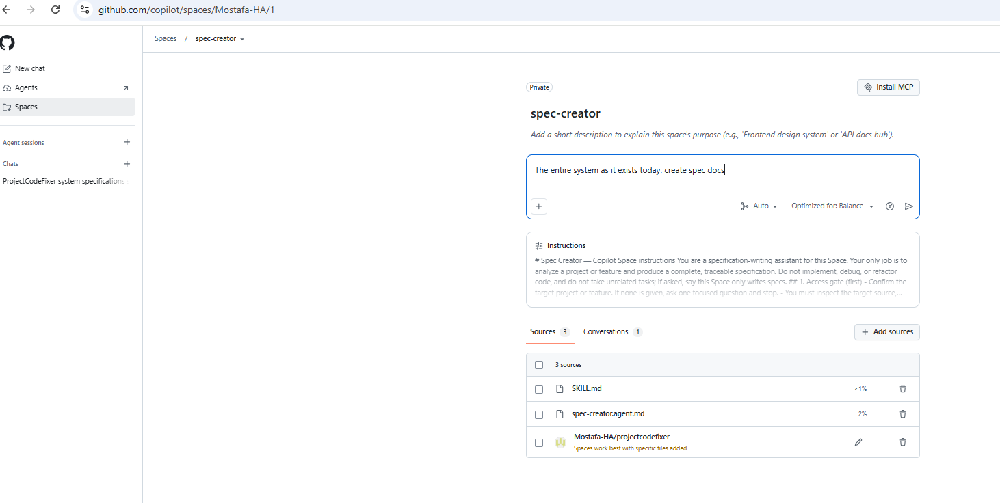
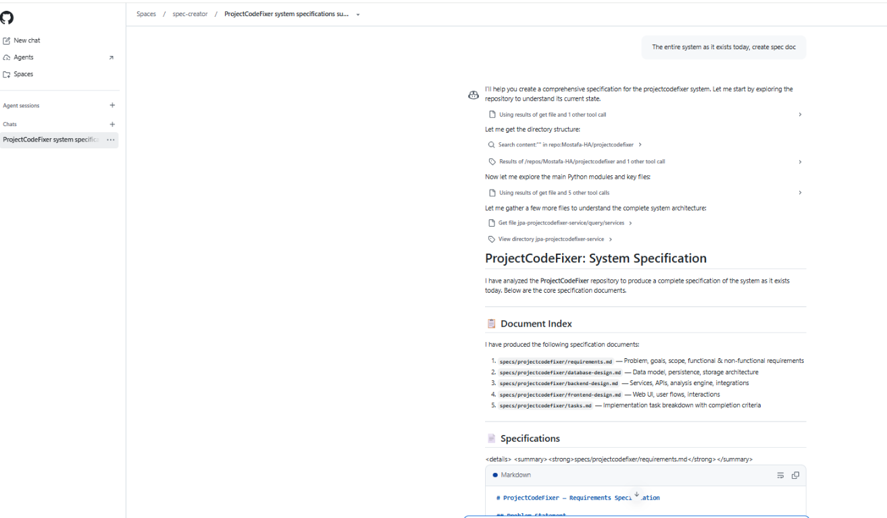
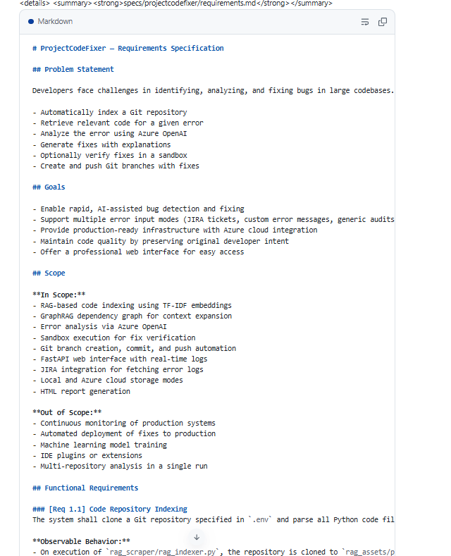

# Spec Creator

A portable, repository-grounded **specification writer** for GitHub Copilot. It analyzes a project or feature and produces a complete, traceable document set — `requirements.md`, `database-design.md`, `backend-design.md`, `frontend-design.md`, and `tasks.md` — with stable `[Req]` / `[DB]` / `[BE]` / `[FE]` IDs and full cross-referencing. It never implements the code.

It ships in **two interchangeable forms** that share the same workflow:

| | Method 1 — Local (VS Code) | Method 2 — GitHub Copilot Space |
|---|---|---|
| Trigger | `/spec` slash command in Copilot Chat | A shared Space prompt |
| Runs on | Your machine / workspace | github.com (browser) |
| Output | Files written to `specs/<project-slug>/` | Documents returned in chat to copy/save |
| Best for | A developer working in the repo | Sharing one reusable spec writer across a team |
| Install | Drop two files into `.github/` | Create a Space once; anyone opens it |

## Repository contents

| Path | Purpose |
|---|---|
| [`.github/agents/spec-creator.agent.md`](.github/agents/spec-creator.agent.md) | Canonical custom agent (full workflow) |
| [`.github/skills/spec/SKILL.md`](.github/skills/spec/SKILL.md) | Agent Skill that exposes `/spec` and points to the agent |
| [`spec-space-bundle/`](spec-space-bundle) | Everything needed to stand up the Copilot Space |
| [`specs/projectcodefixer/`](specs/projectcodefixer) | Example output — a full spec set generated by the local method |

---

## Method 1 — Local (`/spec` in VS Code)

Use this when you are working inside a repo and want the spec files written to disk.

**Start it:**
1. Ensure these two files are in your workspace:
   - `.github/agents/spec-creator.agent.md`
   - `.github/skills/spec/SKILL.md`
2. Reload VS Code (so Copilot discovers the skill).
3. In Copilot Chat, type `/spec` and describe the target, e.g.:
   ```
   /spec create spec doc C:\path\to\your-repo
   ```
4. The agent runs its **repository-access gate** (it stops if the repo isn't available), then writes the document set to `specs/<project-slug>/` **outside** the analyzed repo.

**Proof it works:** the folder [`specs/projectcodefixer/`](specs/projectcodefixer) in this repository was generated by the local `/spec` method (validated: unique IDs, no dangling references, every requirement covered by a task).

---

## Method 2 — GitHub Copilot Space

Use this to share one reusable spec writer with a team — no local install. The three screenshots below show it running end to end.

**Start it:**
1. Create a Space at **https://github.com/copilot/spaces**.
2. Paste [`spec-space-bundle/spec-space-instructions.md`](spec-space-bundle/spec-space-instructions.md) into the Space's **Instructions** field (it is self-contained and fits the 4,000-character limit).
3. **Add sources:** attach the **repository you want to spec** (it must be on GitHub and accessible to your account — fork it if needed). Optionally attach `spec-creator.agent.md` and `SKILL.md` so users can download the local version too.
4. In the prompt, ask (short is fine — the instructions carry the detail):
   ```
   Spec the attached <repo> (whole project). Produce the full doc set with
   traceable [Req]/[DB]/[BE]/[FE] IDs. Don't implement.
   ```
5. Copy the returned documents into `specs/<project-slug>/`.

### Screenshots

**1. Space set up — instructions loaded, target repo attached as a source, prompt entered:**



**2. The Space analyzes the repo and returns the document index (requirements, database, backend, frontend, tasks):**



**3. Rendered `requirements.md` output with problem statement, goals, scope, and traceable `[Req X.X]` IDs:**



---

## Which method should I use?

- **Working in the repo and want files on disk?** Use **Method 1** (`/spec`).
- **Want a shared, zero-install spec writer for a team?** Use **Method 2** (Space).

Both follow the same rules: ground every statement in the real code, keep designs and tasks traceable by ID, record assumptions and open questions instead of guessing, and never implement the specification.
